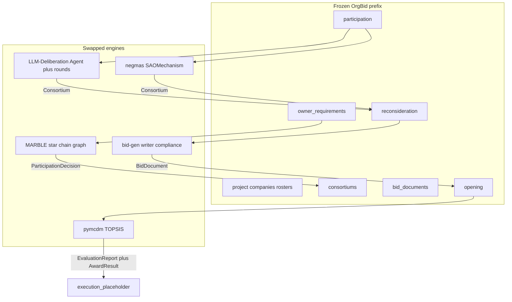

# External baseline shortlist and swap matrix

Fair comparison is **stage-isolated**. Frozen OrgBid `SimulationState` up to the swapped node is reused. Only the named engine at that node is replaced. Hidden labels \(H\) stay out of every engine input. Outputs are written back into OrgBid types (`ParticipationDecision`, `Consortium`, `BidDocument`, `EvaluationReport`, `AwardResult`) so downstream scoring does not change.

This note does **not** authorize vendor clones, paid runs, or editing `src/stages/*.py` in place. PIC commands, token estimates, and zip/LFS: [baseline_slice_comparisons_20261125/README.md](../../results/experiments/baseline_slice_comparisons_20261125/README.md). Adapter wiring detail: [baseline_comparison_implementation_spec.md](baseline_comparison_implementation_spec.md). Paper prose: [external_comparison_experiments.md](../paper/external_comparison_experiments.md). Paper↔repo discrepancies: [paper_repo_component_map.md](paper_repo_component_map.md).



## 1. How a swap is wired (one pattern for all four slices)

- **Do not edit** [src/stages/](../../src/stages/) in place. Add adapters under `src/baselines/` that implement the same async signature the graph node already calls.
- **Dispatch** from the comparison runner (and later, if needed, a flag in [src/workflow.py](../../src/workflow.py)): each of `_participation`, `_consortiums`, `_bid_documents`, `_evaluation`/`_award` calls the adapter instead of the OrgBid function. Current runner: [scripts/run_baseline_slice_comparisons_20261125.py](../../scripts/run_baseline_slice_comparisons_20261125.py).
- **Replay unit** is a frozen checkpoint / Experiment 1 `stage_*.json` (`STAGE_ORDER` in [src/workflow_checkpoint.py](../../src/workflow_checkpoint.py)). Start at the swapped stage; do not regenerate upstream LLM artifacts.
- **Third-party code** stays out of `src/`. Pip-installable libraries are optional extras. Script repos are pinned checkouts under `vendor/baselines/<name>/`, same boundary rule as [vendor/gba/](../../vendor/gba/).
- **Scoring** stays ours: [config/micro_org_rubric.json](../../config/micro_org_rubric.json) plus the slice metrics below. Their native scores are covariates only.

## 2. Master swap matrix

**Never swapped:** case loaders ([src/case_sources.py](../../src/case_sources.py), [data/](../../data/)), hidden \(H\), roster generation, owner requirements, opening admissibility, reconsideration license set \(L\), GBA env, [src/run_audit.py](../../src/run_audit.py), prompt contracts / validators, R1–R6 judge.

**Swapped only at the named node.**

| Slice | Graph node in [src/workflow.py](../../src/workflow.py) | OrgBid symbol replaced | External import | Adapter |
|---|---|---|---|---|
| Intra-firm | `participation` (also reusable on owner_requirements / bid_documents discussion) | [src/agent_runtime.py](../../src/agent_runtime.py) `AgentRuntime.discuss_async` + `organization_mode` | MARBLE `marble.graph.agent_graph` + `marble.engine.engine.Engine` with `--coordinate_mode` | `src/baselines/intra_marble.py` (stub) |
| Intra-firm (action host) | not a LangGraph node; CP07/D3 path | [src/actions/organization_strategy.py](../../src/actions/organization_strategy.py) `OrganizationDiscussionActionStrategy.execute` | same MARBLE graph; `star` ↔ D3 synthesis, `chain` ↔ S4 | `src/baselines/intra_marble_action.py` (not started) |
| Consortium floor | `consortiums` | [src/group_discussion.py](../../src/group_discussion.py) `run_inter_company_discussion` **and** the lead `ask_json` CONSORTIUM emit in [src/stages/consortiums.py](../../src/stages/consortiums.py) | LLM-Deliberation `agent.Agent`, `rounds.py` loop, `evaluation.eval_utils.calculator` / `extract_deal` | `src/baselines/consortium_llm_delib.py` (stub) |
| Consortium floor (non-LLM) | `consortiums` | same two symbols | `negmas.SAOMechanism`, `negmas.AspirationNegotiator`, `negmas.make_issue`, `negmas.preferences.LinearAdditiveUtilityFunction` | `src/baselines/consortium_negmas.py` (stub) |
| Bid document | `bid_documents` | [src/stages/bid_documents.py](../../src/stages/bid_documents.py) `generate_bid_documents` LLM rounds (`section_drafting` / `internal_review` / `final_submission`) | bid-gen `scripts/bid_writer.py`, `bid_compliance.py`, `bid_verify.py` (not a pip package) | `src/baselines/bidgen_writer.py` (stub; plan name `biddoc_bidgen.py`) |
| Eval + award | `evaluation` then `award` | [src/stages/evaluation.py](../../src/stages/evaluation.py) `evaluate_bids` **and** [src/stages/award.py](../../src/stages/award.py) `make_award_decisions` | numpy TOPSIS now; optional `pymcdm.methods.TOPSIS` later | `src/baselines/award_topsis.py` (**implemented**; plan name `award_pymcdm.py`) |
| Numeric rank (host) | methods registry, not the graph | [src/methods/qs_bid.py](../../src/methods/qs_bid.py) `rank_bids` (weighted sum) | `pymcdm.methods.TOPSIS` and `pymcdm.methods.WSM` on the same `BidRankInput` matrix | `src/baselines/rank_pymcdm.py` (not started) |

**Kept on the consortium node (not swapped):** intra-firm `runtime.discuss_async` rounds 1–3 in `form_consortiums` (need / partner / agreement). Only the **inter-firm floor** (rounds 4–5 + JSON emit) is replaced.

**Kept on the bid-document node:** eligibility filters (`no_bid`, unformed consortium, condition desk). Only the **text/schema generation** of `BidDocument` is replaced.

**Kept on eval/award:** [src/stages/opening.py](../../src/stages/opening.py) `open_bids` produces the admissible set. TOPSIS never sees rejected bids.

## 3. Slice 1 — numerical ranking into evaluation / award

**Keep.** Frozen state after `opening`. Inputs: `state.bid_documents`, `state.opening_record`, package budget, public \(\theta_f\).

**Replace.** LLM owner discussion in `evaluate_bids` / `make_award_decisions` (2 rounds each).

**External packages** (optional pip extra `baselines-award`).

- `pymcdm.methods.TOPSIS` — primary ranker (minmax normalization, default in the library). **This repo currently uses numpy TOPSIS** in `award_topsis.py` so the slice can run with zero new dependencies.
- `pymcdm.methods.WSM` — sensitivity: same matrix, weighted-sum analogue of `rank_bids`. Current sensitivity engine: `weighted_sum` in the same module.
- `pymcdm.helpers.rrankdata` — rank vector.
- `pymcdm.correlations.weighted_spearman` / `pearson` — agreement with OrgBid ranking and with \(H\). Current code reports Kendall \(\tau\).

**Adapter contract.** Build a matrix (rows = admissible bidders, columns = quotation, schedule tightness, declared risk scalar, public capability). Price is cost-type, capability is benefit-type. Weights: equal, then entropy. Write `EvaluationReport` with ranked `recommended_winner` and `AwardResult.selected_bidder_id` = TOPSIS top-1. Empty opened set still yields no-award.

**Also planned:** `rank_pymcdm.py` offline on host `BidRankInput` objects to compare TOPSIS vs exact `rank_bids` without the LLM eval layer.

**Metrics.** Top-1 overlap vs OrgBid winner and vs \(H\) (post-hoc only; comparable when exactly one historical firm matches the package role); Kendall \(\tau\); nDCG@k (not yet computed); runtime; tokens = 0.

## 4. Slice 2 — LLM-Deliberation / NegMAS into consortium floor

**Keep.** `form_consortiums` candidate pool, intra-firm rounds 1–3, reconsideration node (`reconsider_after_failed_consortiums`) unchanged so \(L\) stays an OrgBid-only extra.

**Replace.**

- `run_inter_company_discussion(...)` (external rounds `external_role_negotiation`, `external_accountability_confirmation`).
- Lead `runtime.for_entity(...).ask_json_async(..., "CONSORTIUM", ...)` that currently emits `formed` / `not_formed`.

**External (LLM).** Not a pip package. Pin `vendor/baselines/llm-deliberation` to [S-Abdelnabi/LLM-Deliberation](https://github.com/S-Abdelnabi/LLM-Deliberation).

- `agent.py` `Agent` — one instance per firm at the floor (Rep only).
- `rounds.py` — multi-turn public messages.
- `evaluation/eval_utils.py` `calculator`, `extract_deal` — score a deal vector against private issue tables.
- `evaluation/score_leakage.py` — leakage covariate.

**Issue encoding (our adapter, their scorer).** Issues A–D: lead identity, work-share \(\sigma_i\) bins, price split, risk allocation. Private score files are generated from \(\theta_f^{\mathrm{priv}}\) and package budget; **not** from \(H\). Min-threshold = reservation (walk-away). Deal → our `Consortium` (`member_company_ids`, shares). Invalid or below-min deal → `not_formed`, then OrgBid reconsideration.

**External (non-LLM control).** Pip extra `baselines-negotiate`.

- `negmas.SAOMechanism` + `AspirationNegotiator` on the same four issues.
- `LinearAdditiveUtilityFunction` from the same private tables.
- Outcome mapping identical to LLM-Deliberation so utilities are comparable.

**rfq-bench is metrics-only**, not an engine: reuse surplus-over-walk-away definitions from `rfq_bench.core.scoring` / `utility.py` if vendored later; do not run their 5+8 RFQ scenarios as OrgBid evidence.

**Metrics.** Deal rate; joint and min-player utility vs reservation; \(\|\sigma - \sigma_{\mathrm{capacity}}\|\); leakage rate; rounds; tokens.

## 5. Slice 3 — MARBLE into intra-firm deliberation

**Keep.** Participation task loop, `require_management_decision`, condition evidence, `final_agent` as the only writer of `ParticipationDecision`.

**Replace.** Body of `AgentRuntime.discuss_async` when `organization_mode` is the treatment. MARBLE supplies member messages; OrgBid Rep still emits the JSON decision (single external voice).

**External.** Pin `vendor/baselines/MARBLE` to [ulab-uiuc/MARBLE](https://github.com/ulab-uiuc/MARBLE).

- `marble.graph.agent_graph` — topology.
- `marble.engine.engine` — iteration loop.
- `coordinate_mode`: `star` (Rep-centric, analogue of `multi` with synthesis), `chain` (analogue of `solo`/S4 serial), `graph` (unconstrained).
- Do **not** use MARBLE scenarios (`research`, `bargaining`, `coding`, `minecraft`). The task adapter injects our participation prompt + member roster as the environment description.

**Action-host twin.** For CP07-style option selection, wrap `OrganizationDiscussionActionStrategy.execute`: MARBLE members produce comments; host still selects among **pre-validated** `option_id`s (their comments remain non-evidence, matching the current strategy docstring).

**Metrics.** Paired R1–R6 on the same units as [scripts/micro_org_experiment.py](../../scripts/micro_org_experiment.py); calls/tokens vs paper call counts; decision-flip vs `single`; leakage / out-of-role rate. MARBLE `planning_scores` / `communication_scores` are process covariates only.

## 6. Slice 4 — bid-gen into bid documents

**Keep.** Who may submit; consortium lead aggregation; `require_bid_document_shape`.

**Replace.** Three LLM rounds in `generate_bid_documents` that currently fill quotation / schedule / technical proposal / risk_response.

**External.** Pin `vendor/baselines/claude-bid-gen` to [tiettuo/claude-bid-gen](https://github.com/tiettuo/claude-bid-gen). Not pip-installable; call scripts as subprocesses with a temp tender dir.

- `scripts/bid_writer.py` — chapter generation.
- `scripts/bid_compliance.py` / `bid_verify.py` — mechanical gates (covariates).
- Skip DOCX assembly / Chinese format / similarity anti-collusion unless running a secondary document-quality table.

**Adapter.** Materialize owner brief + package \(R\) + firm profile into bid-gen’s expected `extracted/` JSON. After write, parse chapters into our `BidDocument` fields. If a field cannot be parsed, leave it empty and fail the OrgBid shape validator the same way a bad LLM draft would — no silent fill.

**Metrics.** R2 / R3 / R5 on the bid-document unit type; required-section hit rate; fabricated-standard count from their compliance log; tokens vs OrgBid’s 3 rounds.

## 7. What is not a pipeline swap

| Repo | Role in this plan |
|---|---|
| rfq-bench | Surplus / ZOPA metric formulas only |
| NegotiationArena | Dropped (redundant, license null) |
| ConstructSim | Design reference for post-award tracing; wrong stage; no license |
| ProcureGym | Literature only; drug Markov game; no license |
| OrgForge | Audit-design analogue of I6; not a tender engine |

## 8. Comparison harness (when experiments are later authorized)

Current entry (this repo):

```bash
python3 scripts/run_baseline_slice_comparisons_20261125.py prepare|unpack|dry-run|status|run|score
```

Planned generic entry (not created, to avoid a second CLI): `scripts/run_baseline_slice.py --slice award|consortium|intra|biddoc --engine pymcdm|llm_delib|negmas|marble_star|marble_chain|bidgen`. Use the dated runner until a follow-up consolidates names.

- One slice per run. Never mix engines in one graph.
- Budget ledger via existing [src/run_audit.py](../../src/run_audit.py). Freeze accepted runs with [scripts/freeze_experiment.py](../../scripts/freeze_experiment.py).
- Optional extras in [pyproject.toml](../../pyproject.toml): `baselines-award` (`pymcdm`), `baselines-negotiate` (`negmas`). MARBLE / LLM-Deliberation / bid-gen remain vendor checkouts, not core deps.

Historical CP07 and micro-org authorization files are not launch credentials. Set `IMPLEMENTED = True` on an adapter only after a dry-run on CASE-0014 writes a valid OrgBid type.
