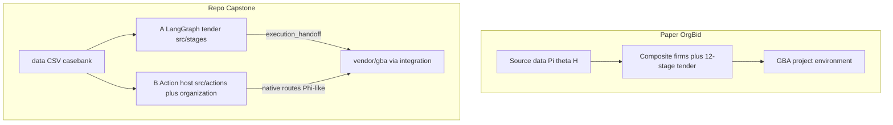

# OrgBid paper ↔ Capstone repo mapping

Source: ARIN7600 Final Report (*OrgBid*). The repository self-describes as Capstone micro–macro tender simulation ([README.md](../../README.md), [docs/architecture.md](../../docs/architecture.md)); the string **OrgBid does not appear** in runtime code. Research notes after 2026-11-25 use OrgBid as the paper’s name for the same tendering protocol.

There are **two coupled systems** in code. The paper’s micro tender protocol maps mainly to (A); the paper’s “106-action / 8-role host” style continuous simulation is largely (B), which the paper under-describes relative to repo docs.

Related notes: [external baseline shortlist](external_baseline_shortlist.md), [implementation spec](baseline_comparison_implementation_spec.md), [paper drop-in §4.6/§5.9](../paper/external_comparison_experiments.md). Discrepancies below are flags. They are not a license to rewrite frozen results or to close gaps in `src/` unless a later task names that gap.

## 1. Component correspondence (paper → code)

### 1.1 Source data / tendering instance \(I\)

| Paper | Code |
|---|---|
| Projects \(\Pi\), enterprises \(\theta_f\), hidden \(H\) | [data/](../../data/) (`simulation_input_*.csv`, match/hidden benchmark under `data/test_sources/casebank_enterprise_matched/`); loaders in [src/case_sources.py](../../src/case_sources.py) |
| Case / package units | Case IDs `CASE-*`, packages via [integration/catalog.py](../../integration/catalog.py) |
| Hidden \(H\) (partners, contract values, durations) | `hidden_benchmark_project_enterprises.csv` (copies under `data/` and `validation/`). CSV usage note: not for simulation input |

[data/README.md](../../data/README.md) states **352** project records, 904 enterprises, 499 historical-relationship rows, 433 labeled project–role units. The paper’s “331 projects” is the deduped project-group count used in [research/PLAN.md](../PLAN.md).

### 1.2 Micro: composite firm + deliberation

| Paper | Code |
|---|---|
| Firm \(f=\langle\theta,A,\Lambda,\mathrm{Agg},\mathrm{Rep}\rangle\) | [src/models.py](../../src/models.py) `Company` + `MemberAgent` roster; parallel host [src/organization/](../../src/organization/) `Organization` / `MemberConfiguration` |
| Roster \(g\), 4–6 members | [src/stages/rosters.py](../../src/stages/rosters.py); prompt [prompts/company/roster.md](../../prompts/company/roster.md) (“Create 4 to 6 key members only”) |
| \(\mathrm{Rep}\), graded authority | `final_agent` in [src/state_ops.py](../../src/state_ops.py); free-text `decision_authority` (`final` / `review`) — **not** formal \(\lambda\): advise≺assess≺decide. Fallback is the last roster member |
| \(\mathrm{DELIBERATE}\) / \(\mathrm{Agg}\) | [src/agent_runtime.py](../../src/agent_runtime.py) `discuss_async` (concurrent members via `asyncio.gather`, then Rep summary); [src/discussion_participants.py](../../src/discussion_participants.py) |
| Visibility last6 / mem5 / floor last8 | Approximate windows, not named constants: member context `previous[-6:]` and memory `[-5:]` in [src/agent_runtime.py](../../src/agent_runtime.py) (`_agent_memory`); floor `previous[-8:]` in [src/group_discussion.py](../../src/group_discussion.py); related packing in [src/discussion_context.py](../../src/discussion_context.py), [src/member_context.py](../../src/member_context.py). Stage prompts also slice `[-8:]` or `[-6:]` (participation, evaluation, award, reconsideration) |
| Modes single / solo / multi | `organization_mode` in [src/agent_runtime.py](../../src/agent_runtime.py); Experiment 1 runner [scripts/micro_org_experiment.py](../../scripts/micro_org_experiment.py) |
| D3 / S4 review arms | Host: [src/actions/organization_strategy.py](../../src/actions/organization_strategy.py); CP prep under `scripts/prepare_capstone_cp07_*.py` |
| G3 (generic reviewers) | Described in paper and [research/paper/CAPSTONE_paper_revision_validation_methodology.md](../paper/CAPSTONE_paper_revision_validation_methodology.md); **absent** from `src/` tender runners and from frozen [results/experiments/](../../results/experiments/) (PIC extract under `21 nov updates/`, not a frozen `results/` arm) |

### 1.3 Micro: 12-stage procurement (Table 2 / Alg 1)

Exact stage spine in [src/workflow_checkpoint.py](../../src/workflow_checkpoint.py) `STAGE_ORDER` and [src/workflow.py](../../src/workflow.py). Round counts \(K_s\) for stages 4–11 **match** the paper’s Table 2 values in the stage files.

| # | Paper stage | Repo node / file | \(K_s\) in code |
|---|---|---|---|
| 1 | Project instantiation | `project` → [src/stages/project_setup.py](../../src/stages/project_setup.py) | n/a (or case-loaded in Experiment 1) |
| 2 | Firm instantiation | `companies` → `generate_companies` | n/a |
| 3 | Roster generation | `rosters` → [src/stages/rosters.py](../../src/stages/rosters.py) | n/a |
| 4 | Requirement refinement (\(K_s=3\)) | `owner_requirements` → [src/stages/owner_requirements.py](../../src/stages/owner_requirements.py) | 3: `department_requirements`, `cross_department_revision`, `final_tender_requirements` |
| 5 | Bid/no-bid (\(K_s=2\)); \(\Delta\) | `participation` → [src/stages/participation.py](../../src/stages/participation.py); decisions `bid` / `no_bid` / `bid_with_consortium` in [src/prompt_contracts.py](../../src/prompt_contracts.py) | 2: `initial_opinion`, `response_and_revision` |
| 6 | Consortium | `consortiums` → [src/stages/consortiums.py](../../src/stages/consortiums.py) + [src/group_discussion.py](../../src/group_discussion.py) | intra 3 (`consortium_need_statement`, `partner_response`, `consortium_agreement`) then inter-firm 2 (`external_role_negotiation`, `external_accountability_confirmation`) then lead JSON |
| 7 | Licensed reconsideration | `reconsideration` → [src/stages/reconsideration.py](../../src/stages/reconsideration.py) | 2: `failed_consortium_reconsideration`, `final_reconsideration` |
| 8 | Bid prep (draft/review/submit) | `bid_documents` → [src/stages/bid_documents.py](../../src/stages/bid_documents.py) | 3: `section_drafting`, `internal_review`, `final_submission` |
| 9 | Opening | `opening` → [src/stages/opening.py](../../src/stages/opening.py) | 2 observational: `submission_check`, `evaluation_handoff_observation` |
| 10 | Evaluation | `evaluation` → [src/stages/evaluation.py](../../src/stages/evaluation.py) | 2: `department_evaluation`, `comparative_review` |
| 11 | Award | `award` → [src/stages/award.py](../../src/stages/award.py) | 2: `award_risk_review`, `final_award_alignment` |
| 12 | Contract signing & handoff | `execution_placeholder` → [src/stages/execution_handoff.py](../../src/stages/execution_handoff.py) | **placeholder** (`status: not_implemented_in_mvp`); not the paper’s ≤3-draft signing |

Experiment 1’s runner ([scripts/micro_org_experiment.py](../../scripts/micro_org_experiment.py)) collapses the graph into three scored stages (`owner`, `bidders`, `award`) while still calling the same stage functions in order inside `bidders` and `award`.

### 1.4 Audit / safeguards

| Paper | Code (approximate) |
|---|---|
| Audit trail \(\mathcal{A}\), provenance | [src/run_audit.py](../../src/run_audit.py), [src/actions/runner.py](../../src/actions/runner.py) `ActionAuditRecord`, workflow checkpoints |
| Output validator + repair | [src/prompt_contracts.py](../../src/prompt_contracts.py), [src/response_repair.py](../../src/response_repair.py), [src/verification.py](../../src/verification.py) |
| Condition-review module | [src/condition_review.py](../../src/condition_review.py) |
| Named invariants I1–I6 | **No named I1–I6 set**; partial behavioral analogues only (see discrepancies) |

### 1.5 Macro / micro–macro coupling

| Paper | Code |
|---|---|
| GBA rule-based environment | [vendor/gba/](../../vendor/gba/) |
| Contract layer \(\Phi\), event feedback | [integration/](../../integration/) (`run.py`, `native_routes.py`, `action_macro_mapping.py`, `native_contract_supply.py`); package shares & shared caps in [integration/catalog.py](../../integration/catalog.py) |
| Scenario package fractions | design 3%, cost consulting 1.5%, two construction packages 42.5% each (85% of owner budget), supply 12% of project budget per construction package and marked `included_in_parent` (~28% of that construction package), remaining ~10.5% unallocated as scenario contingency |
| Shared enterprise parameters | every enterprise: capability fields 0.8, `qualification_level` 0.85, `total_resource_capacity` 2.0 ([integration/catalog.py](../../integration/catalog.py) `enterprise_parameters`) |
| Organizational memory from env events | Host/org memory paths; tender handoff JSON carries qualitative fields the env does **not** consume |

### 1.6 Experiments (paper §4–5 → frozen evidence)

| Paper | Primary repo locations |
|---|---|
| Exp1 single/solo/multi | [results/experiments/micro-org-1118/](../../results/experiments/micro-org-1118/), [micro-org-replication-20261119/](../../results/experiments/micro-org-replication-20261119/), [micro-org-extension12-20261119/](../../results/experiments/micro-org-extension12-20261119/); rubric [config/micro_org_rubric.json](../../config/micro_org_rubric.json) |
| Exp2 S4/D3/(G3) | Narrative in [research/paper/](../paper/); CP07 offline S/D3/S4 in [results/experiments/org_deliberation_metrics_20261119/](../../results/experiments/org_deliberation_metrics_20261119/) — **G3 not frozen in `results/`** |
| Exp3 robustness | [results/experiments/org_ablation_sensitivity_20261119/](../../results/experiments/org_ablation_sensitivity_20261119/) (8 windows, 72 calls) |
| Env / e2e CASE-0014 etc. | [results/experiments/e2e-case*](../../results/experiments/), `paired-full-*`; paper extract under `21 nov updates/` |
| Planned Exp 4–7 (external slices) | [research/paper/external_comparison_experiments.md](../paper/external_comparison_experiments.md); harness [results/experiments/baseline_slice_comparisons_20261125/](../../results/experiments/baseline_slice_comparisons_20261125/) |

Experiment 1 `multi` generation on the twelve frozen projects: 3,308 requests, ~20.09M input / ~2.13M output tokens (sum of the three batch reports). Judge recorded on disk as `deepseek-flash`. `full_run.zip` in each micro-org directory is Git LFS (133-byte pointer until `git lfs pull`).

## 2. Discrepancies (flagged)

Do not silently “fix” frozen results to match the paper, or rewrite the paper from this note without an explicit revision task.

### 2.1 High — paper claims a component the tender graph does not implement

1. **Stage \(s_{12}\) contract signing (≤3 drafts, accept/revise/reject, re-tender / suspend).** Repo ends at `execution_placeholder` / `write_execution_handoff` with status effectively MVP handoff ([src/stages/execution_handoff.py](../../src/stages/execution_handoff.py)). Draft loops exist later in the **action host** (owner/contractor formation), not as LangGraph stage 12, and without the paper’s hard 3-draft / \(+\Delta T_p\) / suspend protocol.

2. **Consortium unanimity \(o_{G,p}=\prod \mathrm{acc}_f\).** Tender formation lets the lead LLM emit `formed`/`not_formed` ([src/stages/consortiums.py](../../src/stages/consortiums.py)); product-of-acceptances exists only as a separate host API (`unanimous` in [src/coordination/negotiations.py](../../src/coordination/negotiations.py)) and is **not** wired into the tender consortium stage.

3. **Named invariants I1–I6.** No code symbols or enforcement suite for leakage freedom \(H\), boundary encapsulation, single voice, commitment consistency, award legality, provenance completeness as a closed set. Related pieces exist piecemeal (audit logs, verification, reconsideration licensing, hidden-CSV comments) but are not the paper’s invariant table. Do not cite code identifiers I1–I6.

4. **Authority ladder \(\lambda_{\mathrm{advise}}\prec\lambda_{\mathrm{assess}}\prec\lambda_{\mathrm{decide}}\).** Implementation uses free-text `decision_authority` with Rep = first `"final"`; fallback roster uses `review`/`final`. Paper’s three-level \(\Lambda\) is not a typed protocol right.

5. **G3 configuration (Exp2).** Described in paper and methodology notes; **absent** from `src/` runners and from frozen [results/experiments/](../../results/experiments/) (no G3 arm in the org_deliberation freeze; referenced d3s4 extract lives under `21 nov updates/`).

### 2.2 Medium — numbers / evidence mismatch

6. **Projects: 331 vs 352.** Paper “331 projects” = deduped `project_groups`; [data/README.md](../../data/README.md) correctly states **352** CSV rows / 904 / 499 / 433 units.

7. **Exp1 task count / judge.** Paper: 241 tasks, Qwen judge. Frozen micro-org evidence: 96 participation + 12 owner briefs + submitted bids + 43 evaluation-and-award products on the `multi` arm across twelve projects; reports list **686** scored outputs in the first six-project batch protocol and ~217–218 paired comparisons. Judge recorded as `deepseek-flash` (not Qwen) in those result trees. If a regenerated listing disagrees with the paper, use the frozen `summary.json`.

8. **Paired env case set incomplete in `results/experiments/`.** Paper lists 12 environment cases; several (0006, 0007, 0010, 0012, 0019) appear in paper extracts / inventories but not as frozen paired lifecycle under `results/experiments/` (paths may point at missing `runs/…`).

9. **Roster size 4–6.** Prompt requests it; [src/prompt_contracts.py](../../src/prompt_contracts.py) `require_roster_shape` only requires non-empty + ≥1 `final` — size band not enforced. Host role JSONs often use **3** members (D3-style), vs paper deliberative 4–6.

### 2.3 Medium — dual architecture under-specified by paper relative to repo

10. **Two organizational stacks.** Paper presents one composite-agent + LangGraph story. Repo also has a full **106-action / 8-role** host ([config/action_registry.json](../../config/action_registry.json), [src/actions/](../../src/actions/), [docs/architecture.md](../../docs/architecture.md): Owner, Bank, Architect, Engineer, QS, Government, Contractor, Supplier) that drives continuous GBA coupling. Tender company roles are a smaller set (owner / designer / supplier / contractor / supervisor). Readers of the paper alone will miss this parallel surface.

11. **Naming.** Product name **OrgBid** (paper) vs **Capstone / codedemo** (repo). No rename sync in `src/`.

### 2.4 Lower — acknowledged limitations that match

12. Shared capability parameterization so awards move but project indices barely change — present in [integration/catalog.py](../../integration/catalog.py) and paper §5.4.

13. Env consumes structured contract fields, not qualitative bid/risk prose — consistent between paper and handoff/native supply code.

14. Exp1 stage-isolated design (multi upstream artifacts reused) — matches research notes / experiment design; paper also notes this limit.

## 3. What this note does not authorize

- Overwriting frozen scores, inputs, or unknown-request logs.
- Implementing stage-12 signing, named I1–I6, typed \(\lambda\), or consortium unanimity unless a later task names that change.
- Treating G3 PIC extracts under `21 nov updates/` as frozen `results/` evidence.
- Pooling Experiments 4–7 with Experiments 1–3.
